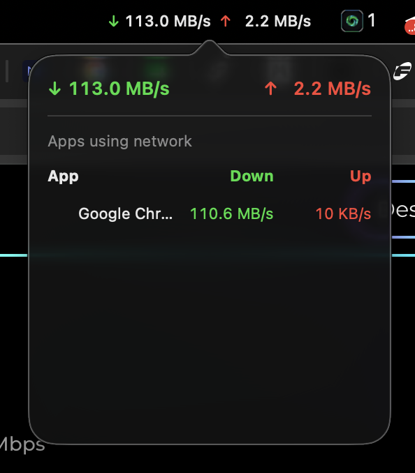

# NetSpeed

A tiny, native macOS menu bar app that shows your real-time network upload/download speed — no Electron, no third-party dependencies, just Swift + AppKit.



## Features

- Live download (green) / upload (red) speed in the menu bar, fixed-width so it never jitters
- Click to open a popover with:
  - Current speed
  - Top apps/processes currently using the network (`App | Down | Up`), with app icons
- No Dock icon, lives entirely in the menu bar
- Per-app network breakdown only polls while the popover is open, to keep idle CPU/overhead near zero
- Pure AppKit — no SwiftUI, no Charts, no third-party dependencies at all

## Requirements

- macOS 12+
- Xcode Command Line Tools (`xcode-select --install`) — no full Xcode or extra dependencies needed

## Build & run

```bash
git clone https://github.com/<your-username>/NetSpeed.git
cd NetSpeed
swiftc main.swift -o NetSpeed -framework Cocoa -O
./NetSpeed
```

To have it start automatically at login, add it as a Login Item in System Settings → General → Login Items, pointing to the compiled `NetSpeed` binary.

## How it works

- Total throughput is read straight from interface counters via `getifaddrs` (`en*`/`utun*` interfaces), sampled every second.
- Per-app breakdown shells out to the built-in `nettop` command-line tool (no sudo required) and diffs per-process byte counters between polls to compute a rate.
- The popover UI is built with plain `NSView`/`NSStackView`/Auto Layout — no SwiftUI — to keep the dependency surface as small as possible.

## License

MIT — see [LICENSE](LICENSE).

---

*Disclaimer: this tool was built through AI + human collaboration. It's a personal utility I made for my own use, and I'm keeping this repo as a backup for the future and sharing it with the community in case it's useful to anyone else looking for something simple.*
